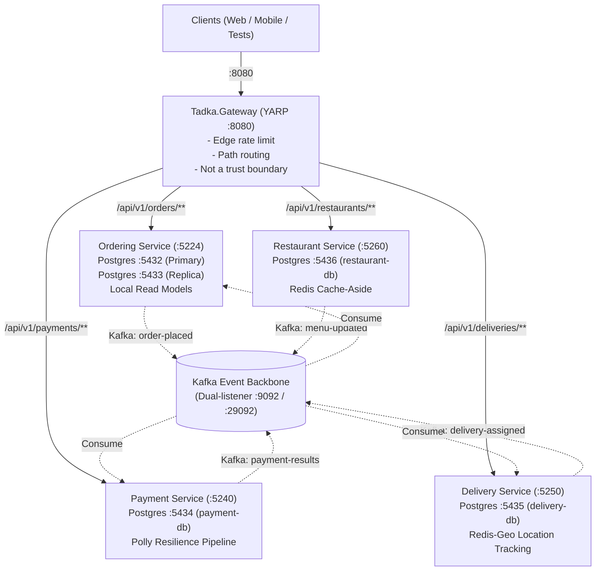
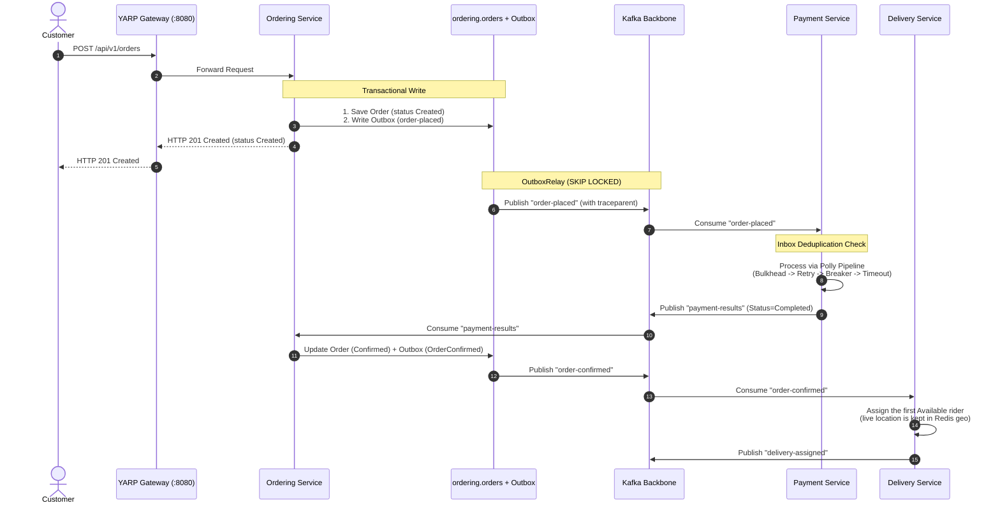
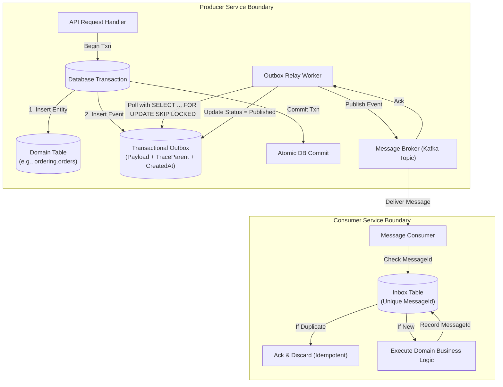
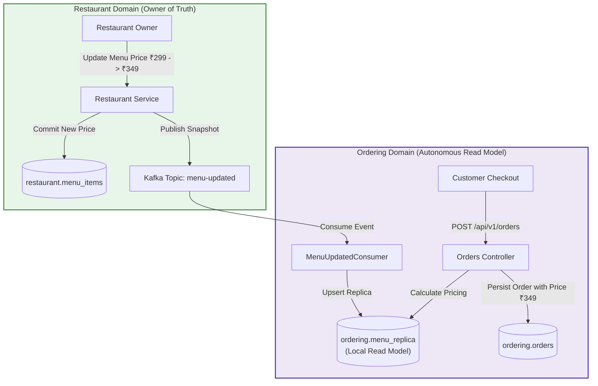
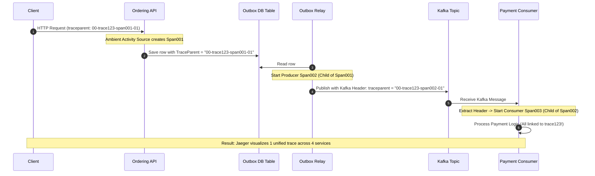
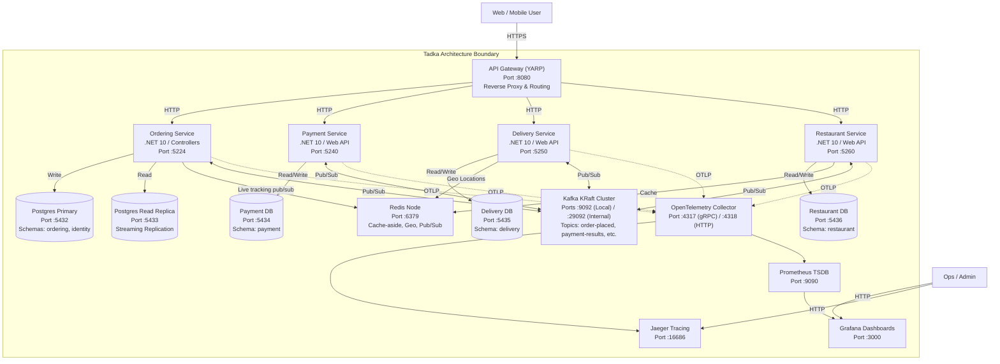

# Visual Architectural Blueprint Catalog

> **Desi Architect Cohort, Architecture Diagrams Collection**  
> All diagrams are authored in GitHub-flavored Mermaid.js for interactive rendering and version control.

---

## 1. System Evolution: Monolith to 4 Microservices + Gateway

This diagram illustrates the architectural state of Tadka as completed on Day 16:

---

## 2. The Choreographed Saga Flow (Order Placement & Payment)

Illustrates the asynchronous event choreography between `Ordering`, `Payment`, and `Delivery` without a centralized orchestrator:

---

## 3. Transactional Outbox + Relay + Inbox Deduplication Flow

Guarantees at-least-once publishing and exactly-once processing effect across distributed databases:

---

## 4. Polly Resilience Pipeline (ADR-021, ADR-043)

The layered resilience pipeline protecting external synchronous calls (e.g. Payment Gateway):

```mermaid
flowchart LR
    Request["Incoming External Call"] --> Bulkhead["1. Bulkhead<br/>(Max 10 Concurrent)"]
    Bulkhead --> Retry["2. Jittered Retry<br/>(Transport Errors ONLY, Max 2 Retries)"]
    Retry --> Breaker["3. Circuit Breaker<br/>(Ratio 0.5, Min 5 calls, 30s window, 60s open)"]
    Breaker --> Timeout["4. Timeout<br/>(2.0s per attempt)"]
    Timeout --> Gateway["External Gateway / HTTP Endpoint"]

    classDef normal fill:#e1f5fe,stroke:#0288d1,stroke-width:2px;
    classDef warning fill:#fff3e0,stroke:#f57c00,stroke-width:2px;
    classDef danger fill:#ffebee,stroke:#d32f2f,stroke-width:2px;

    class Request,Timeout normal;
    class Bulkhead,Retry warning;
    class Breaker danger;
```

---

## 5. Event-Carried State Transfer & Local Read Models (ADR-037)

Eliminating temporal coupling on the order placement critical path:

---

## 6. Distributed Trace Context Propagation (ADR-041)

Preserving end-to-end W3C trace identity across HTTP, Outbox, and Kafka:

---

## 7. C4 Container Diagram: Tadka Production Architecture

Level 2 Container Diagram showing technologies, ports, and protocols:

