# Tadka Diagram Gallery: one diagram of every kind

Nineteen diagrams of the **real Tadka system**, one for each type in [The Architect's Toolset](THE_ARCHITECTS_TOOLSET.md#3-the-diagrams-an-architect-draws). Open this file on GitHub or in VS Code with a Mermaid preview and every diagram renders.

> **How accurate is this?** Every name, port, topic, table, state and number was taken from the code on branch `day-16`, from `deploy/azure/*.tf`, or from a real trace captured from the running system. Where a diagram is a judgement and not a fact (the Wardley-style map), it says so. Where Tadka does **not** have something (for example a separate analytics store), the diagram does not draw it.

| # | Diagram | Question it answers |
|---|---|---|
| 1 | [System context](#1-system-context) | Who uses Tadka, and what outside systems does it touch? |
| 2 | [Container](#2-container-diagram) | What are the deployable pieces and how do they talk? |
| 3 | [Component](#3-component-diagram-inside-the-orders-service) | What is inside the Orders service? |
| 4 | [Code (class)](#4-code-diagram-the-order-aggregate) | How are the Order classes related? |
| 5 | [Deployment](#5-deployment-diagram-azure-container-apps) | Where does each piece run in the cloud? |
| 6 | [Sequence](#6-sequence-diagram-placing-an-order) | In what order do the parties talk when an order is placed? |
| 7 | [Flowchart](#7-flowchart-how-a-payment-is-processed) | How does a payment decide and branch? |
| 8 | [State machine](#8-state-machine-the-order) | Which states can an order be in, and which moves are legal? |
| 9 | [ER diagram](#9-er-diagram-the-orders-database) | Which tables and relations exist in the Orders database? |
| 10 | [Data flow](#10-data-flow-diagram-where-personal-and-money-data-goes) | Where does sensitive data come from, rest and go? |
| 11 | [Context map](#11-domain-or-context-map) | How do the bounded contexts relate? |
| 12 | [Event storming](#12-event-storming-board) | What happens in the business, in time order? |
| 13 | [Network topology](#13-network-topology-azure-session) | What is public, private, and behind which boundary? |
| 14 | [Dependency graph](#14-dependency-graph) | Who calls whom, and where is the cycle? |
| 15 | [Trace waterfall](#15-trace-waterfall-one-real-order) | Where did one real order spend its time? |
| 16 | [Latency budget](#16-latency-budget) | Where do the milliseconds go? |
| 17 | [Roadmap](#17-roadmap-the-16-day-evolution) | In what order did the system change? |
| 18 | [Decision tree](#18-decision-tree-should-this-be-its-own-service) | When does something become its own service? |
| 19 | [Wardley-style map](#19-wardley-style-map-what-is-commodity-and-what-is-ours) | What is commodity and what is our edge? |

---

## 1. System context

**C4 level 1.** The whole of Tadka is one box. Only people and outside systems appear.

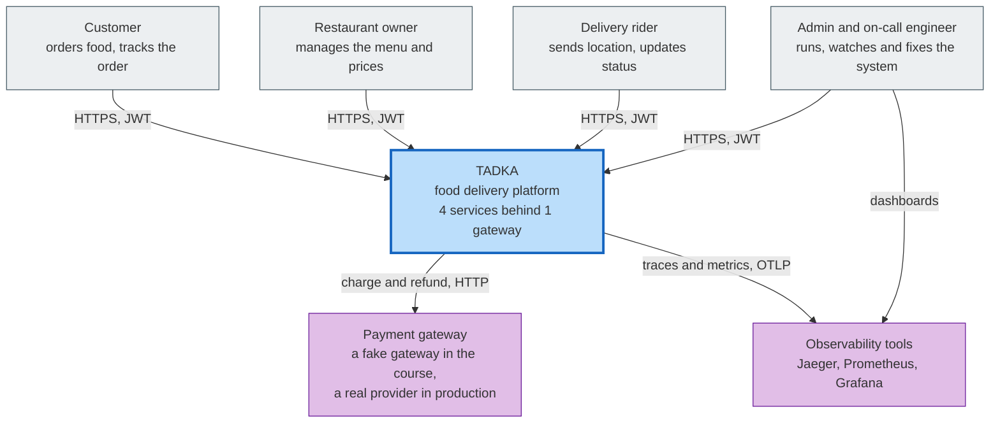

**What to notice:** only one external business dependency (payments). There is no SMS, maps or search provider in the code.

---

## 2. Container diagram

**C4 level 2.** Every deployable piece, with its port. These are the ports used in the Day 16 runbook.

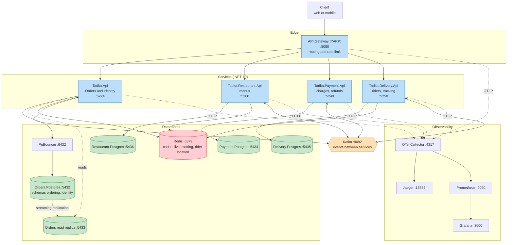

**What to notice:**
- Each service owns its own database. Nothing reaches into another service's database.
- Only Orders uses PgBouncer and a read replica.
- Kafka is the only way services talk to each other for business events.

---

## 3. Component diagram: inside the Orders service

**C4 level 3.** The parts inside `Tadka.Api`. Names are real classes and folders.

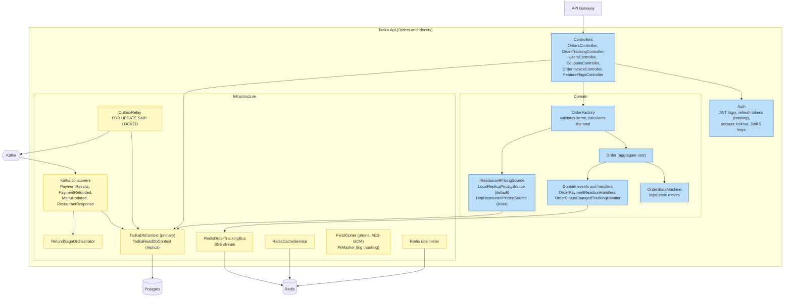

**What to notice:** the order and its outbox event are saved through the **same** `TadkaDbContext` in one transaction. The relay, not the controller, talks to Kafka.

---

## 4. Code diagram: the Order aggregate

**UML class diagram.** One module, real members from `src/Tadka.Api/Domain/Orders/`.

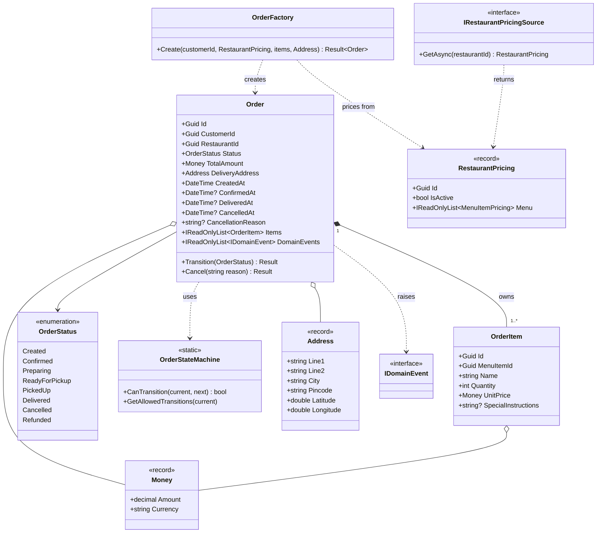

**What to notice:** every property on `Order` has a private setter. State changes only through `Transition` and `Cancel`, so the state machine cannot be bypassed. `Refunded` exists in the enum, but no transition leads into it yet.

---

## 5. Deployment diagram: Azure Container Apps

**Where each piece runs** in a live class session, created by `scripts/cloud-up.ps1` from `deploy/azure/*.tf`. Front Door is optional (a free trial cannot create it). `basic` and `ha` modes differ where noted.

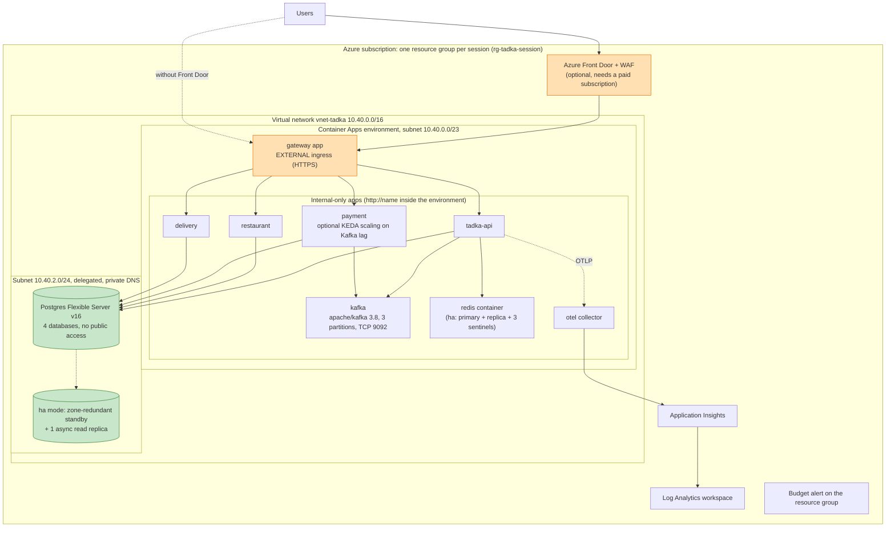

**What to notice:** the gateway is the **only** app with a public address. Postgres has no public access at all. The session is deleted with `scripts/cloud-down.ps1`, and a budget alert guards the cost.

---

## 6. Sequence diagram: placing an order

**One scenario, end to end.** Topic names are the real Kafka topics. The numbers are the order of events.

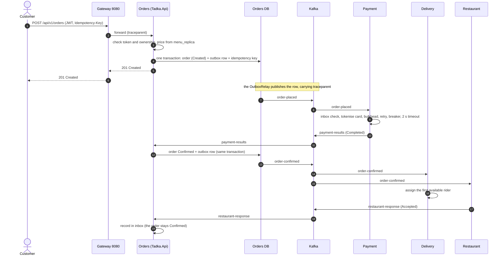

**What to notice:** the customer gets the 201 **before** payment happens (step 4). The charge, confirmation and rider assignment run afterwards through Kafka. That is why the Day 16 load test found the queue, not the API, saturating first.

---

## 7. Flowchart: how a payment is processed

**One process, with its branches.** Real order of the layers in `PaymentResiliencePipeline.cs`: bulkhead, retry, circuit breaker, timeout.

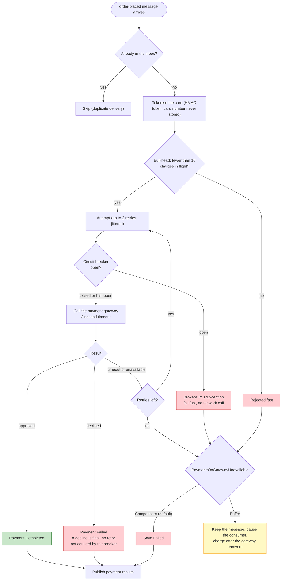

**What to notice:** a **decline** and an **outage** take different paths. Mixing them up (retrying a decline) is the bug the Day 14 predicate prevents.

---

## 8. State machine: the order

**One entity.** Straight from `OrderStateMachine.cs`.

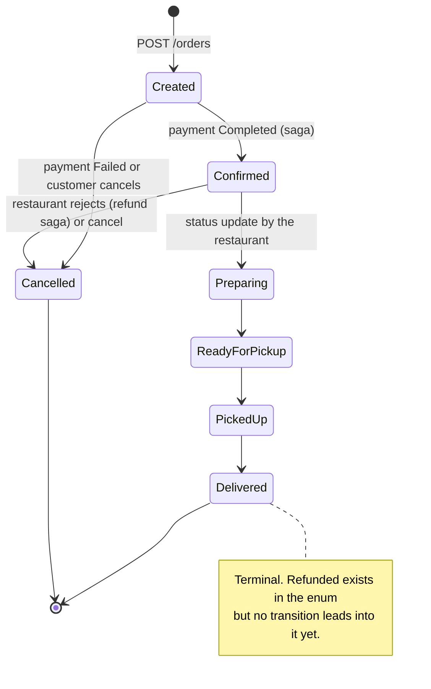

**What to notice:** cancel is legal only from `Created` or `Confirmed`. After the food is `Preparing`, the API returns **422** if you try to cancel.

---

## 9. ER diagram: the Orders database

**One database.** Tables from `src/Tadka.Api/Data/`. Dotted lines are links by **id only**: there is no foreign key across schemas (ADR-008).

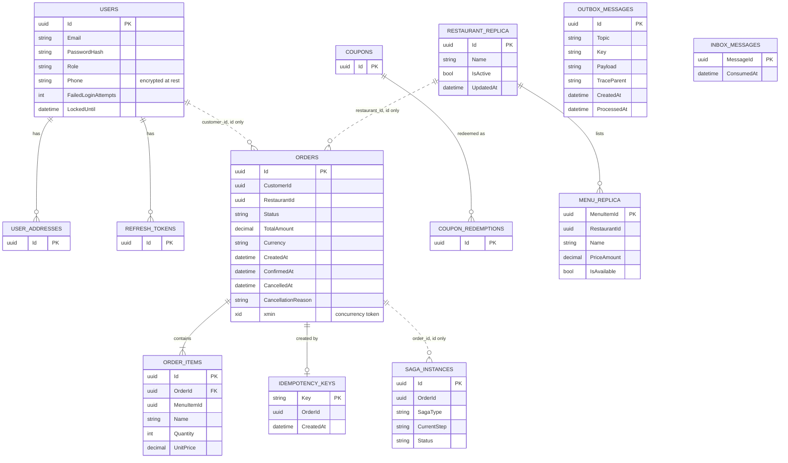

**What to notice:** `outbox_messages` and `inbox_messages` have no relation to `orders`. They are a separate channel written in the **same transaction**. The other services have their own databases: Payment (`payments`), Delivery (`agents`, `assignments`, `pending_assignments`, `cancelled_orders`), Restaurant (`restaurants`, `menu_items`, `order_decisions`). Each also has its own `outbox_messages` and `inbox_messages` where it publishes or consumes events.

---

## 10. Data flow diagram: where personal and money data goes

**For security and privacy reviews.** Circles are processes, cylinders are stores, rectangles are outside parties, dashed boxes are trust boundaries.

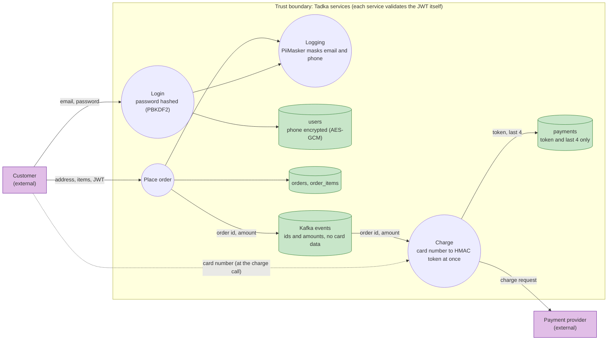

**What to notice:** the card number exists only in memory during the charge call. It is turned into a keyed token immediately (ADR-053) and never stored or logged. Order ids go on traces and logs, never on metric labels (ADR-042). The right to be forgotten anonymises the user and keeps the money records (ADR-032).

---

## 11. Domain or context map

**DDD view.** Four bounded contexts, and how each relates to the others. Identity lives inside the Orders deployable as its own schema.

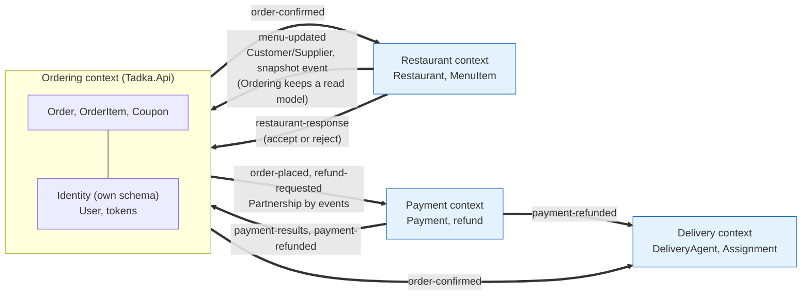

**What to notice:** the arrows carry **events**, not function calls. Ordering never calls Restaurant for a price: it owns a copy (`menu_replica`), the integration pattern DDD calls a local read model fed by a published language. Orders and Identity are one deployable but two schemas (a shared kernel kept small on purpose).

---

## 12. Event storming board

**The business in time order.** Orange are events (past tense), blue are commands, yellow are actors, purple are reactions ("policies").

```mermaid
flowchart LR
    a1["Customer"]:::actor --> c1["Place order"]:::cmd --> e1["OrderPlaced<br/>(order-placed)"]:::event
    e1 --> p1["When an order is placed,<br/>charge the customer"]:::policy --> c2["Charge"]:::cmd
    c2 --> e2["PaymentCompleted"]:::event
    c2 --> e3["PaymentFailed"]:::event
    e2 --> p2["When payment completes,<br/>confirm the order"]:::policy --> e4["OrderConfirmed<br/>(order-confirmed)"]:::event
    e3 --> p3["When payment fails,<br/>cancel the order"]:::policy --> e5["OrderCancelled"]:::event
    e4 --> p4["When confirmed,<br/>find a rider"]:::policy --> e6["RiderAssigned<br/>(delivery-assigned)"]:::event
    e4 --> p5["When confirmed,<br/>ask the restaurant"]:::policy --> a2["Restaurant"]:::actor
    a2 --> e7["RestaurantAccepted"]:::event
    a2 --> e8["RestaurantRejected"]:::event
    e8 --> p6["When rejected after payment,<br/>refund"]:::policy --> e9["RefundRequested"]:::event --> e10["PaymentRefunded"]:::event
    a3["Restaurant owner"]:::actor --> c3["Change menu price"]:::cmd --> e11["MenuUpdated<br/>(menu-updated)"]:::event
    e11 --> p7["When a menu changes,<br/>update the local prices"]:::policy

    classDef event fill:#ffcc80,stroke:#e65100;
    classDef cmd fill:#90caf9,stroke:#1565c0;
    classDef actor fill:#fff59d,stroke:#f9a825;
    classDef policy fill:#ce93d8,stroke:#6a1b9a;
```

**What to notice:** the event names match real Kafka topics, so the board and the code tell the same story. A real event storming session is done with sticky notes and the business people, and the result looks like this before anyone draws a service boundary.

---

## 13. Network topology: Azure session

**What is public, private, and behind which boundary.** From `deploy/azure/main.tf`, `apps.tf` and `postgres.tf`.

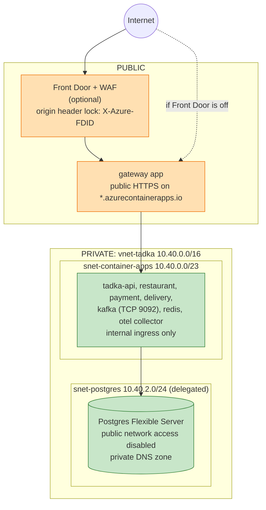

**What to notice:** exactly one thing is reachable from the internet. With Front Door on, the gateway answers **403** to any request that does not carry the right `X-Azure-FDID` header, so nobody can skip the WAF by calling the gateway address directly. Locally, the equivalent is simply `localhost` with ports.

---

## 14. Dependency graph

**Who calls whom.** Solid arrows are synchronous HTTP. Dashed arrows go through Kafka topics. The only **cycle** is Orders and Payment, and it is asynchronous.

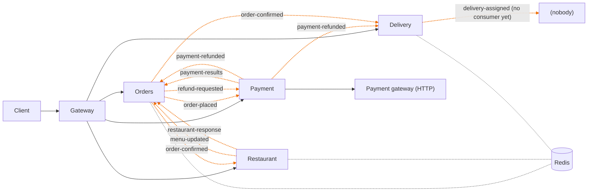

**What to notice:** there is **no** synchronous call between two business services. The `HttpRestaurantPricingSource` exists only as a lever (`Ordering:RestaurantReadMode=SyncHttp`) to show the coupling it would create. The `delivery-assigned` topic is published but nothing consumes it yet.

---

## 15. Trace waterfall: one real order

**One real trace**, captured from the running system (Jaeger) during the Day 16 load runs on a laptop. One order produced **13 spans across all 5 services**, in a single trace.

```mermaid
gantt
    title One real order: spans over time (milliseconds from the first request)
    dateFormat x
    axisFormat %L
    section Gateway
    POST /api/v1 (gateway)            :g1, 0, 391ms
    section Orders
    POST api/v1/orders                :o1, 5, 386ms
    outbox publish order-placed       :o2, 416, 21ms
    consume payment-results           :o3, 855, 50ms
    outbox publish order-confirmed    :o4, 956, 18ms
    consume restaurant-response       :o5, 1421, 9ms
    section Payment
    consume order-placed              :p1, 432, 222ms
    ProcessPayment                    :p2, 435, 211ms
    outbox publish payment-results    :p3, 847, 8ms
    section Delivery
    consume order-confirmed           :d1, 974, 14ms
    section Restaurant
    consume order-confirmed           :r1, 974, 11ms
    outbox publish restaurant-response :r2, 1360, 60ms
```

| Service | Span | Start (ms) | Duration (ms) |
|---|---|---:|---:|
| Gateway | POST /api/v1/{**remainder} | 0 | 391 |
| Orders | POST api/v1/orders | 5 | 386 |
| Orders | outbox publish order-placed | 416 | 21 |
| Payment | consume order-placed | 432 | 222 |
| Payment | ProcessPayment | 435 | 211 |
| Payment | outbox publish payment-results | 847 | 8 |
| Orders | consume payment-results | 855 | 50 |
| Orders | outbox publish order-confirmed | 956 | 18 |
| Delivery | consume order-confirmed | 974 | 14 |
| Restaurant | consume order-confirmed | 974 | 11 |
| Restaurant | outbox publish restaurant-response | 1,360 | 60 |
| Orders | consume restaurant-response | 1,421 | 9 |

**What to notice:** the customer's request ends at about **391 ms**. The charge, confirmation and restaurant response happen in the **next 1,000 ms** through Kafka. The trace was taken under load, so the 391 ms is higher than a quiet run would show. The gaps between spans are time spent in the queue.

---

## 16. Latency budget

**Where the milliseconds go**, using the same real trace. The promise to the customer is the **synchronous** part: order placement under **500 ms at p99**.

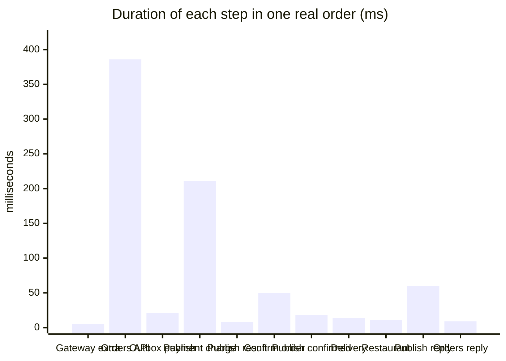

| Part | Budget | Measured in this trace | Where |
|---|---|---|---|
| **Synchronous: customer waits** (gateway + Orders API) | **500 ms p99** | **391 ms** | One request through the gateway |
| Of which gateway overhead | small | about 5 ms | Gateway span minus Orders span |
| Asynchronous: charge, confirm, restaurant reply | no customer wait | about 1,000 ms after the 201 | Kafka hops |
| Largest async step | n/a | Payment charge, about 211 ms | `ProcessPayment` (fake gateway) |

**What to notice:** the synchronous budget is almost all spent inside the Orders API (386 of 391 ms). Anything added to that path (a new call, a new query) must fit in the remaining gap, so it is a budget decision. On a quiet machine the same call is a small fraction of this, because this trace was captured under k6 load.

---

## 17. Roadmap: the 16-day evolution

**In what order the system changed.** Each day answers one failure with one decision.

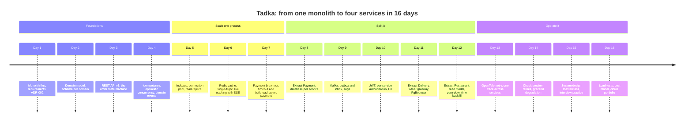

**What to notice:** nothing was split before a real force appeared. Payment left first because of **fault and PCI isolation**, Delivery for its **write profile**, and Restaurant because of **team ownership**.

---

## 18. Decision tree: should this be its own service?

**One choice.** The four valid triggers, with the Tadka extraction that used each one.

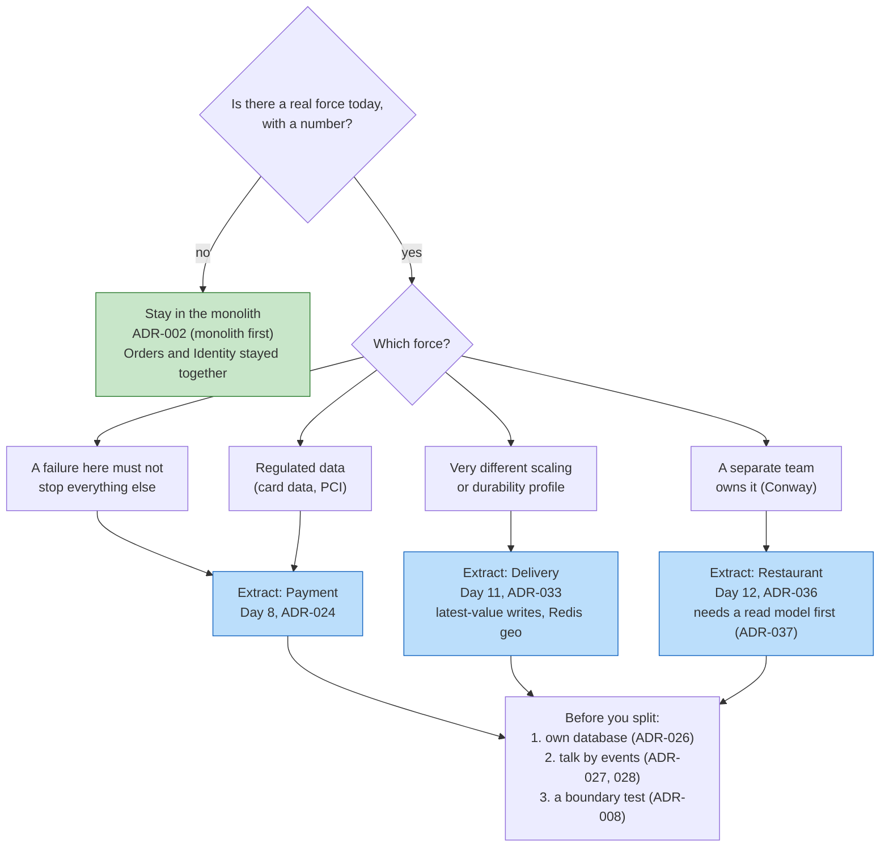

**What to notice:** "it is faster" or "it is modern" is not on the tree. Splitting for performance was explicitly **rejected** for Payment, because the in-process fix on Day 7 already solved the latency.

---

## 19. Wardley-style map: what is commodity and what is ours

**An opinion, not a measurement.** Mermaid has no Wardley map, so this is a quadrant chart: left to right is how mature the thing is in the market (genesis to commodity), bottom to top is how visible it is to the customer. The placement is the author's judgement and is **meant to be argued with**.

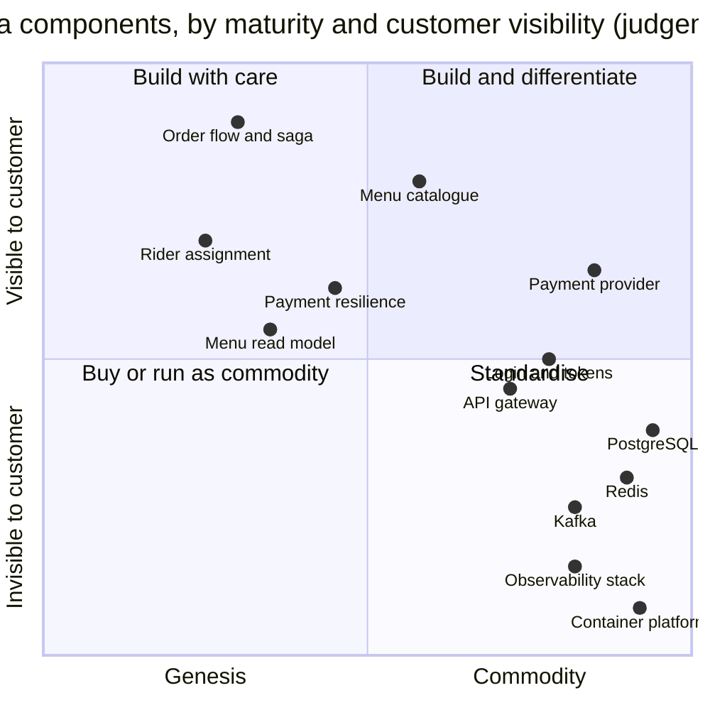

**How to read it:** items on the left are where the company's own judgement and code matter (the order flow, how riders are assigned, how the read model stays fresh). Items on the right are commodities: buy or run them, and do not build your own. The lesson for an architect is to spend design effort **on the left** and to **standardise on the right**.

---

*Back to:* [The Architect's Toolset](THE_ARCHITECTS_TOOLSET.md) · [Tadka field manual](README.md) · [DIAGRAMS.md](DIAGRAMS.md) (the earlier, shorter set).
