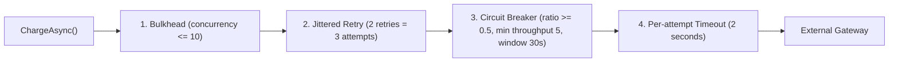

# Day 14: Runbook: Resilience & Chaos Engineering (Circuit Breaker, Buffer Mode, Cache Fall-Through)

**Branch:** `day-14`  ·  **What changed since Day 13:** [`docs/changelog.md`](../changelog.md).

Day 13 made the 4-service system observable; Day 14 makes it **survivable** — and measures every failure on the Day-13 dashboards. The Polly resilience pipeline completes the synchronous **Payment → Gateway** integration ([ADR-043](../adrs/043-circuit-breaker-retry-backoff.md)); dependency classification and graceful degradation establish platform survivability policies ([ADR-044](../adrs/044-graceful-degradation-dependency-classification.md)).

> **The Essential Architectural Reframe:** The Ordering → Payment hop is asynchronous Kafka ([Day 9](../adrs/028-transactional-outbox-inbox.md)) — when the Payment service is offline, Kafka simply buffers messages without data loss. The circuit breaker lives exclusively on the one synchronous network call we do not control: **Payment Service → External Payment Gateway (Razorpay/Stripe)**.

> **Distinguish the Two Failures:** "Payment is down" is ambiguous.
> 1. **Payment Service Down (Process Crash):** The .NET process is dead. Kafka queues `order-placed`. No circuit breaker is involved; this is handled by container restarts and consumer group offset management.
> 2. **Payment Gateway Down (External Outage):** The Payment service is healthy and consuming from Kafka, but its HTTP calls to the external provider time out or return 5xx. The circuit breaker and `Payment:OnGatewayUnavailable` lever decide what happens to the customer's *order*.

Every command below is given twice, bash first and PowerShell second, wherever the two shells differ. Windows PowerShell 5.1 cannot read an HTTP status code off a 4xx/5xx response without throwing, so the `Get-StatusCode` helper defined in section 1 is reused throughout.

---

## 1. Start the stack

### Demo Day Fresh Reset (Clean Slate)
To start from a clean slate (wiping database volumes and Prometheus TSDB metrics):

**Bash:**
```bash
docker compose --profile observability down -v --remove-orphans && docker compose --profile observability up -d
until docker inspect tadka-kafka --format "{{.State.Health.Status}}" | grep -q healthy; do sleep 3; done
until docker inspect tadka-restaurant-db --format "{{.State.Health.Status}}" | grep -q healthy; do sleep 3; done
docker compose ps
```

**PowerShell:**
```powershell
docker compose --profile observability down -v --remove-orphans; docker compose --profile observability up -d
do { Start-Sleep -Seconds 3 } until ((docker inspect tadka-kafka --format "{{.State.Health.Status}}") -eq "healthy")
do { Start-Sleep -Seconds 3 } until ((docker inspect tadka-restaurant-db --format "{{.State.Health.Status}}") -eq "healthy")
docker compose ps
```

---

### Standard Launch
If starting existing containers without wiping data:
```bash
git checkout day-14
docker compose --profile observability up -d
until docker inspect tadka-kafka --format "{{.State.Health.Status}}" | grep -q healthy; do sleep 3; done
until docker inspect tadka-restaurant-db --format "{{.State.Health.Status}}" | grep -q healthy; do sleep 3; done
docker compose ps
```
```powershell
git checkout day-14
docker compose --profile observability up -d
do { Start-Sleep -Seconds 3 } until ((docker inspect tadka-kafka --format "{{.State.Health.Status}}") -eq "healthy")
do { Start-Sleep -Seconds 3 } until ((docker inspect tadka-restaurant-db --format "{{.State.Health.Status}}") -eq "healthy")
docker compose ps
```

**Build once before starting the apps:**
```bash
dotnet build Tadka.slnx
```
```powershell
dotnet build Tadka.slnx
```

**Pre-create the eight Kafka topics this branch uses (SASL):**
```bash
for t in order-placed payment-results order-confirmed delivery-assigned refund-requested payment-refunded menu-updated restaurant-response; do
  docker exec tadka-kafka /opt/kafka/bin/kafka-topics.sh --bootstrap-server localhost:9092 --command-config /etc/kafka/docker/client.properties --create --if-not-exists --topic $t --partitions 1 --replication-factor 1
done
```
```powershell
foreach ($t in "order-placed","payment-results","order-confirmed","delivery-assigned","refund-requested","payment-refunded","menu-updated","restaurant-response") {
  docker exec tadka-kafka /opt/kafka/bin/kafka-topics.sh --bootstrap-server localhost:9092 --command-config /etc/kafka/docker/client.properties --create --if-not-exists --topic $t --partitions 1 --replication-factor 1
}
```

### Launch the Five Services
Telemetry export is enabled via `OTEL_EXPORTER_OTLP_ENDPOINT`:

Five processes, five terminals:
```bash
# Terminal 1: Restaurant Service (:5260)
export OTEL_EXPORTER_OTLP_ENDPOINT="http://localhost:4317"
dotnet run --project src/Tadka.Restaurant.Api

# Terminal 2: Payment Service (:5240)
export OTEL_EXPORTER_OTLP_ENDPOINT="http://localhost:4317"
export Payment__CircuitBreakSeconds=15
dotnet run --project src/Tadka.Payment.Api

# Terminal 3: Delivery Service (:5250)
export OTEL_EXPORTER_OTLP_ENDPOINT="http://localhost:4317"
dotnet run --project src/Tadka.Delivery.Api

# Terminal 4: Ordering Monolith (:5224)
export OTEL_EXPORTER_OTLP_ENDPOINT="http://localhost:4317"
dotnet run --project src/Tadka.Api

# Terminal 5: API Gateway (:8080)
export OTEL_EXPORTER_OTLP_ENDPOINT="http://localhost:4317"
dotnet run --project src/Tadka.Gateway
```

```powershell
# Terminal 1: Restaurant Service (:5260)
$env:OTEL_EXPORTER_OTLP_ENDPOINT = "http://localhost:4317"
dotnet run --project src/Tadka.Restaurant.Api

# Terminal 2: Payment Service (:5240)
$env:OTEL_EXPORTER_OTLP_ENDPOINT = "http://localhost:4317"
$env:Payment__CircuitBreakSeconds = "15"
dotnet run --project src/Tadka.Payment.Api

# Terminal 3: Delivery Service (:5250)
$env:OTEL_EXPORTER_OTLP_ENDPOINT = "http://localhost:4317"
dotnet run --project src/Tadka.Delivery.Api

# Terminal 4: Ordering Monolith (:5224)
$env:OTEL_EXPORTER_OTLP_ENDPOINT = "http://localhost:4317"
dotnet run --project src/Tadka.Api

# Terminal 5: API Gateway (:8080)
$env:OTEL_EXPORTER_OTLP_ENDPOINT = "http://localhost:4317"
dotnet run --project src/Tadka.Gateway
```

### PowerShell Status Code Helper & Shared Setup
```powershell
function Get-StatusCode {
    param($Uri, $Method = "GET", $Headers = @{}, $Body = $null, $ContentType = "application/json")
    try {
        $params = @{ Uri = $Uri; Method = $Method; Headers = $Headers; UseBasicParsing = $true }
        if ($Body) { $params.Body = $Body; $params.ContentType = $ContentType }
        return [int](Invoke-WebRequest @params).StatusCode
    } catch {
        if ($_.Exception.Response) { return [int]$_.Exception.Response.StatusCode }
        else { throw }
    }
}
```

```bash
TOKEN=$(curl -s -X POST http://localhost:8080/api/v1/auth/login -H "Content-Type: application/json" -d '{"email":"priya@tadka.test","password":"Password123!"}' | sed -E 's/.*"accessToken":"([^"]+)".*/\1/')
BODY='{"customerId":"c1b2c3d4-0001-4000-8000-000000000001","restaurantId":"a1b2c3d4-0001-4000-8000-000000000001","items":[{"menuItemId":"b1b2c3d4-0001-4000-8000-000000000001","quantity":2}],"deliveryAddress":{"line1":"x","line2":"y","city":"Bangalore","pincode":"560066","latitude":12.93,"longitude":77.61}}'
```
```powershell
$TOKEN = (Invoke-RestMethod -Uri http://localhost:8080/api/v1/auth/login -Method Post -ContentType "application/json" -Body '{"email":"priya@tadka.test","password":"Password123!"}').accessToken
$H = @{ Authorization = "Bearer $TOKEN" }
$BODY = '{"customerId":"c1b2c3d4-0001-4000-8000-000000000001","restaurantId":"a1b2c3d4-0001-4000-8000-000000000001","items":[{"menuItemId":"b1b2c3d4-0001-4000-8000-000000000001","quantity":2}],"deliveryAddress":{"line1":"x","line2":"y","city":"Bangalore","pincode":"560066","latitude":12.93,"longitude":77.61}}'
```

---

### Set up your screen once (every demo below uses it)

Do this before Demo 1 and leave it in place. The demos tell you which window to type in and which tab to look at, using the names below.

**Windows**

| Name used in this runbook | What it is |
|---|---|
| **Restaurant terminal** | Terminal 1 above (`Tadka.Restaurant.Api`) |
| **Payment terminal** | Terminal 2 above (`Tadka.Payment.Api`). Keep it visible: most of what you must see appears here as log lines. |
| **Delivery terminal** | Terminal 3 above |
| **Monolith terminal** | Terminal 4 above (`Tadka.Api`) |
| **Gateway terminal** | Terminal 5 above |
| **Commands terminal** | A sixth window, opened at the repository root. Everything marked **Run** is typed here. |

**Browser tabs.** Open these four tabs now and leave them open.

| Tab | Address | What you use it for |
|---|---|---|
| **Jaeger** | [http://localhost:16686](http://localhost:16686) | How long each order spent inside Payment (the `ProcessPayment` span) |
| **Prometheus** | [http://localhost:9090](http://localhost:9090) | The circuit-breaker counters |
| **Grafana** | [http://localhost:3000](http://localhost:3000) (login `admin` / `admin`), then Dashboards, then the folder **Tadka**, then **Tadka, System Overview (RED + business)** | The payment success and failure rates |
| **Kafka UI** | [http://localhost:8090](http://localhost:8090) | Consumer lag, in the Buffer-mode demo |

**Log in and load the helpers in the Commands terminal.** First run the login and `$BODY` lines from "PowerShell Status Code Helper & Shared Setup" above. Then paste the helpers for your shell. They save you from typing long one-liners, and each demo calls them by name:

**PowerShell:**
```powershell
# Flip the fake payment gateway between Fast, Slow, Failing and Outage. Takes effect on the NEXT charge, no restart.
function Set-GatewayBehavior([string]$Value) {
    $f = "src\Tadka.Payment.Api\appsettings.Development.json"
    (Get-Content $f -Raw) -replace '"Behavior": "[A-Za-z]*"', ('"Behavior": "' + $Value + '"') | Set-Content $f -NoNewline
    Select-String '"Behavior"' $f | ForEach-Object { "gateway Behavior is now: " + $_.Line.Trim() }
}
# Place one order through the gateway and return its id.
function New-Order { (Invoke-RestMethod -Uri http://localhost:8080/api/v1/orders -Method Post -Headers $H -ContentType "application/json" -Body $BODY).id }
function Get-OrderStatus([string]$Id) { (Invoke-RestMethod -Uri "http://localhost:8080/api/v1/orders/$Id" -Headers $H).status }
# Print the order's status once a second, with the time, so you can watch it change.
function Watch-OrderStatus([string]$Id, [int]$Seconds = 10) {
    1..$Seconds | ForEach-Object { "{0:HH:mm:ss}  {1}" -f (Get-Date), (Get-OrderStatus $Id); Start-Sleep -Seconds 1 }
}
```

**Bash:**
```bash
set_gateway() {   # Fast | Slow | Failing | Outage. Takes effect on the NEXT charge, no restart.
  sed -i "s/\"Behavior\": \"[A-Za-z]*\"/\"Behavior\": \"$1\"/" src/Tadka.Payment.Api/appsettings.Development.json
  grep '"Behavior"' src/Tadka.Payment.Api/appsettings.Development.json
}
new_order()    { curl -s -X POST http://localhost:8080/api/v1/orders -H "Authorization: Bearer $TOKEN" -H "Content-Type: application/json" -d "$BODY" | sed -E 's/^\{"id":"([^"]+)".*/\1/'; }
order_status() { curl -s "http://localhost:8080/api/v1/orders/$1" -H "Authorization: Bearer $TOKEN" | sed -E 's/.*"status":"([^"]+)".*/\1/'; }
watch_order()  { for i in $(seq 1 "${2:-10}"); do echo "$(date +%T)  $(order_status "$1")"; sleep 1; done; }
```

**How to read the Payment terminal.** Every log line is one JSON object, and the part you read is the text after `"@mt":"`. Ignore the rest of the line. Search the window for these words:

| Search for | It means |
|---|---|
| `Payment COMPLETED` | the charge succeeded |
| `Payment FAILED` | the charge failed; the `Reason` on the same line says why |
| `circuit OPENED` | the breaker tripped and will fail every call fast |
| `circuit HALF-OPEN` | the break time is over and one call is being let through as a probe |
| `circuit CLOSED` | the probe succeeded and normal service resumed |
| `BUFFERED` and `buffered` | Buffer mode is holding the order for later (Demo 1b) |
| `SLOW` | the fake gateway is deliberately taking 8 seconds (Demo 4) |

The symbols in front of some of these lines may print as odd characters in a Windows console. Ignore them; the words are what matter. Windows Terminal has a search box on **Ctrl+Shift+F**.

**Optional: show only those lines.** If the Payment terminal is too busy, stop Payment (**Ctrl+C**) and start it again through a filter. The variables you set before `dotnet run` are unchanged. Use this in place of the plain `dotnet run --project src/Tadka.Payment.Api` line:

**PowerShell:**
```powershell
dotnet run --project src/Tadka.Payment.Api 2>&1 | Select-String -Pattern 'circuit|Payment (COMPLETED|FAILED|BUFFERED)|buffered|SLOW'
```

**Bash:**
```bash
dotnet run --project src/Tadka.Payment.Api 2>&1 | grep -i --line-buffered -E 'circuit|Payment (COMPLETED|FAILED|BUFFERED)|buffered|SLOW'
```
If nothing appears when you expect lines, stop it and use the plain `dotnet run` instead.

> **If you launched the five services exactly as shown above, Payment is already running with the OpenTelemetry variable and a 15 second circuit break. You do not restart it for Demo 1.** Restarting resets the breaker to closed, which would hide the recovery you want to watch.

---

## 2. Architecture: The 4-Layer Polly Resilience Pipeline

In [`src/Tadka.Payment.Api/Resilience/PaymentResiliencePipeline.cs`](../../src/Tadka.Payment.Api/Resilience/PaymentResiliencePipeline.cs), every charge operation passes through four concentric layers:



### Ordering of the layers, outer to inner (as built in the code)
1. **Bulkhead (outermost):** caps concurrent charges (`MaxConcurrentCharges = 10`, no queue). The 11th concurrent call is refused at once with `RateLimiterRejectedException` instead of piling up behind a sick gateway.
2. **Retry:** a failed attempt is tried again with a jittered exponential delay (200 ms base), at most `MaxRetryAttempts = 2` **retries**, so up to **3 attempts**. It handles **transport failures only** (`TimeoutRejectedException`, `PaymentGatewayUnavailableException`). It does **not** handle `BrokenCircuitException`, so an open circuit is never retried (the call fails immediately), and it never handles `PaymentDeclinedException` (a business answer).
3. **Circuit breaker (inside the retry):** it sees **every attempt**, not every order. Three failed attempts of order 1 plus two of order 2 make five calls at 100% failure, which meets `MinimumThroughput = 5` and `FailureRatio = 0.5`, so it opens in the middle of order 2. Only transport failures count; declines do not.
4. **Timeout (innermost):** a hard 2 second deadline for each attempt, so one hanging socket cannot hold a thread for the gateway's full 8 seconds.

The other defensible order puts the breaker **outside** the retry loop. Then the breaker counts whole operations (it would need five failed *orders* to open) and an open breaker skips the retry loop altogether. Tadka counts attempts, which reacts faster, and keeps open-circuit rejections out of the retry policy so the result is the same fail-fast behaviour. The code comment in [`PaymentResiliencePipeline.cs`](../../src/Tadka.Payment.Api/Resilience/PaymentResiliencePipeline.cs) and [ADR-043](../adrs/043-circuit-breaker-retry-backoff.md) record this order.

**Worst-case latency of one charge** (all attempts time out): 3 x 2 s plus two jittered back-offs, about **6.6 seconds** (captured in Demo 4). That number belongs in your latency budget.

---

## 3. Demo 1: Circuit Breaker Lifecycle (Open, Half-Open, Recover)

**What you're proving:** When an external payment gateway suffers an outage, the system automatically stops hammering the failing vendor, fails fast in milliseconds to protect system threads, tests for recovery via a canary probe, and auto-heals when the gateway recovers.

**In one line:** make the gateway fail, send six orders and watch the breaker open; wait 15 seconds and send one more order to watch it probe (half-open); then fix the gateway and send one more order to watch it close.

**Before you start**
- [ ] The five services are running (Section 1) and you are logged in on the Commands terminal.
- [ ] The four browser tabs are open and the helpers are loaded ("Set up your screen once", above).
- [ ] Payment has been running for at least 45 seconds (the consumer-group handover from Day 13). The Payment terminal shows `OrderPlacedConsumer subscribed to order-placed`. Orders sent before that just wait.

**The lever.** `FakePaymentGateway` reads `IOptionsMonitor<PaymentOptions>`, so a saved change to `Payment:Gateway:Behavior` in [`appsettings.Development.json`](../../src/Tadka.Payment.Api/appsettings.Development.json) applies to the **next charge, with no restart**. The helper `Set-GatewayBehavior` / `set_gateway` edits that value for you. Do **not** set the environment variable `Payment__Gateway__Behavior` for these demos: it would win over the file and could not be changed while Payment runs.

### Step 1: Make the gateway fail
**Run** (Commands terminal):

**PowerShell:**
```powershell
Set-GatewayBehavior Outage
```
**Bash:**
```bash
set_gateway Outage
```
**You should see:** `"Behavior": "Outage"`. Nothing else happens yet.

### Step 2: Send six orders
**Run** (Commands terminal). This keeps the six order ids so you can check them in Step 3:

**PowerShell:**
```powershell
$ids = 1..6 | ForEach-Object { New-Order }
```
**Bash:**
```bash
ids=$(for i in 1 2 3 4 5 6; do new_order; done)
```
**You should see:** the command finishes at once with no error. The order is accepted immediately; the charge happens afterwards, through Kafka. The action is in the **Payment terminal**.

### Step 3: Read the Payment terminal (within about 5 seconds)
**Look at:** the Payment terminal. Search for `Payment FAILED` and `circuit`. **You should see, in this order:**
```json
{"@mt":"Payment FAILED for order {OrderId}: {Reason}","Reason":"PaymentGatewayUnavailableException: Gateway unavailable / 5xx (simulated outage)."}
{"@mt":"Payment circuit OPENED for ~{Break}s: gateway looks down; failing fast.","@l":"Error","Break":15}
{"@mt":"Payment FAILED for order {OrderId}: {Reason}","Reason":"BrokenCircuitException: The circuit is now open and is not allowing calls."}
```
What each line means:
- **`PaymentGatewayUnavailableException`**: Payment really called the gateway (up to 3 attempts with a jittered back-off) and the gateway failed every time.
- **`circuit OPENED ... "Break":15`**: five failed attempts inside the 30 second window opened the breaker. It will now refuse every call for 15 seconds.
- **`BrokenCircuitException`**: the later orders never reached the gateway at all. They were refused in milliseconds.

**Then check the orders.** Default `Compensate` mode cancels a failed order, so all six should read `Cancelled` within a few seconds:

**PowerShell:**
```powershell
$ids | ForEach-Object { Get-OrderStatus $_ }
```
**Bash:**
```bash
for id in $ids; do order_status "$id"; done
```

### Step 4: See the same thing in Jaeger
1. Open the **Jaeger** tab ([http://localhost:16686](http://localhost:16686)).
2. In **Service** choose `Tadka.Payment.Api`. In **Operation** choose `ProcessPayment`. Set **Lookback** to *Last 15 Minutes*. Click **Find Traces**.
3. **You should see six traces**, one per order, newest at the top.
4. Click one trace. In the timeline find the row named **`ProcessPayment`** (service `Tadka.Payment.Api`). The time at the right end of that row is how long Payment spent on the charge. That is the number in the table below. It is **not** the total at the top of the page, because the page total also includes the trip through Kafka and the other services.
5. Click the `ProcessPayment` row to open its details. Under **Tags** you should see `order.id`, `payment.amount`, `payment.status = failed`, and an error marker.
6. Open the oldest of the six traces first and work toward the newest.

**Captured live (the `ProcessPayment` span of each order, service `Tadka.Payment.Api`):**

| Order | Took | Why it failed |
|---|---|---|
| 1 | **1,483 ms** | three attempts with jittered back-off; the gateway was `Unavailable` every time |
| 2 | **882 ms** | two attempts; the 5th failed attempt of the burst opened the circuit; the 3rd attempt got `BrokenCircuitException` and was not retried |
| 3 to 6 | **8 to 11 ms** each | `BrokenCircuitException`: no network call, no retry loop |

The three attempts of order 1 are inside that one span, so Jaeger shows one bar, not three. That is the whole point of the breaker: order 1 cost 1.5 seconds of resources, orders 3 to 6 cost 10 milliseconds each.

### Step 5: See HALF-OPEN (it needs one more order)
You will not see `HALF-OPEN` after the burst, however long you wait. The breaker only moves to half-open when a **new call arrives after the 15 second break has passed**. So you have to send that call:

1. In the Payment terminal find the last `circuit OPENED` line and note its time (the `@t` value at the start of the line).
2. Wait at least **15 seconds** (the `Break` value in that line). Count to 20 to be safe.
3. **Run** one more order:

**PowerShell:**
```powershell
New-Order | Out-Null
```
**Bash:**
```bash
new_order > /dev/null
```
4. **Look at the Payment terminal.** Within a second or two you should see `circuit HALF-OPEN`, then (the gateway is still in `Outage`) `circuit OPENED` again for another 15 seconds, then a `Payment FAILED` line for that order ending in `BrokenCircuitException`. The second line is the probe failing: the breaker re-opened as soon as the probe failed, so the order's remaining attempt was refused.

**Captured live:**
```
16:36:17.159  Payment circuit OPENED for ~15s
16:36:53.533  Payment circuit HALF-OPEN: probing the gateway with one request
16:36:53.749  Payment circuit OPENED for ~15s        <- the probe failed (216 ms later)
16:36:53.951  Payment FAILED ... BrokenCircuitException   <- the order behind it fails fast
```
Notice the 36 second gap between the first `OPENED` and `HALF-OPEN`: the circuit sat open until an order arrived. If you only see `BrokenCircuitException` lines and no `HALF-OPEN`, you sent the order before the 15 seconds had passed. Wait and send another.

### Step 6: Recover without a restart
1. **Run** (Commands terminal):

**PowerShell:**
```powershell
Set-GatewayBehavior Fast
```
**Bash:**
```bash
set_gateway Fast
```
2. Wait at least 15 seconds after the **second** `circuit OPENED` line.
3. **Run** one order and watch it:

**PowerShell:**
```powershell
$ID = New-Order
Watch-OrderStatus $ID 15
```
**Bash:**
```bash
ID=$(new_order)
watch_order "$ID" 15
```
4. **You should see** in the Payment terminal `circuit HALF-OPEN`, then `circuit CLOSED`, then `Payment COMPLETED`. In the Commands terminal the order goes from `Created` to `Confirmed` within a few seconds.

**Captured live:**
```
16:37:15.905  Payment circuit HALF-OPEN: probing the gateway with one request
16:37:16.116  Payment circuit CLOSED: gateway healthy again.
16:37:16.119  Payment COMPLETED for order ...
```
The probe was the real customer order. It succeeded, the breaker closed, and the next order was `Confirmed` as normal.

### Step 7: Check the counters in Prometheus
1. Wait **60 to 90 seconds**. The services push metrics once a minute.
2. Open the **Prometheus** tab ([http://localhost:9090](http://localhost:9090)).
3. Type this into the box at the top and click **Execute**, then open the **Table** tab:
```promql
sum by (state) (tadka_payment_circuit_transitions_total)
```
4. **You should see** three rows: `{state="open"}`, `{state="half_open"}` and `{state="closed"}`. For exactly Steps 1 to 6 the counts are **open 2, half_open 2, closed 1** (the burst opened it, the failed probe re-opened it, then one half-open and one close on recovery). If you ran the demo in the last few minutes the numbers include those earlier trips. Click the **Graph** tab to see the counts step up.

**Captured live:** `open` 3, `half_open` 2, `closed` 1 (the counts included an earlier Payment instance's first trip).

### Step 8 (optional): The same story in Grafana
Open the **Grafana** tab, then the dashboard **Tadka, System Overview (RED + business)**. Set the time range (top right) to *Last 15 minutes*. In the panel **Payment results by status** the `failed` line rises during Steps 2 to 5 and `success` appears after Step 6. Both lag by about a minute.

### Demo 1a: A decline must not trip the breaker
**What you're proving:** a card decline is a business answer, not an outage. It must never open the breaker. The breaker should be closed now (end of Step 6).

1. **Run:** `Set-GatewayBehavior Failing` (bash: `set_gateway Failing`).
2. **Run** six orders as in Step 2: `$ids = 1..6 | ForEach-Object { New-Order }` (bash: `ids=$(for i in 1 2 3 4 5 6; do new_order; done)`).
3. **Look at the Payment terminal.** You should see six `Payment FAILED` lines whose reason is a decline, and **no line containing `circuit`**.
4. **Look at Jaeger** (Find Traces again): each `ProcessPayment` span takes about 0.2 seconds, because there is a single attempt and no retry.
5. **Look at Prometheus:** run the Step 7 query again after a minute. The counts have not changed.

**Captured live:** six orders with the gateway declining each took 209 to 223 ms (a single attempt: no retry), and the Payment log had **zero** circuit lines.

> **Critical teaching contrast: Decline vs. Outage.** `Failing` (insufficient funds, card declined) never trips the breaker. Conflating declines with outages is an anti-pattern.

**Reset after Demo 1:**
```powershell
Set-GatewayBehavior Fast
git checkout -- src/Tadka.Payment.Api/appsettings.Development.json
```
```bash
set_gateway Fast
git checkout -- src/Tadka.Payment.Api/appsettings.Development.json
```
(The second line restores the file exactly as committed. Keep `Behavior` at `Fast` between demos while you are still working, and run `git checkout` once when you are completely finished.)

---

## 4. Demo 1b: Compensate vs. Buffer Mode (Fix 2 / ADR-043)

When a payment gateway is temporarily unreachable, how should the platform handle in-flight orders?

| Mode | Behavior during Gateway Outage | Customer Experience | Kafka Queue |
|---|---|---|---|
| **`Compensate`** (Default) | Records `payment.status = failed`; triggers saga compensating rollback. | Order is cancelled immediately. Customer must re-order. | Consumer offsets committed. Queue stays flat. |
| **`Buffer`** (ADR-043) | Deletes pending row; seeks back Kafka offset; pauses consumer. | Order remains `Created`. Automatically confirms when gateway recovers. | Consumer group lag increases during outage. |

**Before you start:** the gateway is at `Fast` and the breaker is closed (end of Demo 1). Payment runs in the default `Compensate` mode.

### Step 1: Compensate mode (the default)
1. **Run** (Commands terminal):

**PowerShell:**
```powershell
Set-GatewayBehavior Outage
$ID = New-Order
Watch-OrderStatus $ID 15
```
**Bash:**
```bash
set_gateway Outage
ID=$(new_order)
watch_order "$ID" 15
```
2. **You should see** the status print `Created` and then `Cancelled` within a second or two. The customer would have to order again.
3. **Look at the Payment terminal:** a `Payment FAILED` line with the gateway reason.
4. **Look at Jaeger** (Service `Tadka.Payment.Api`, Operation `ProcessPayment`, Find Traces): the newest trace's `ProcessPayment` span has `payment.status = failed`.
5. Count the payment rows for the order. One failed row exists in this mode:

**PowerShell:**
```powershell
docker exec tadka-payment-db psql -U tadka -d tadka_payment -t -c "select count(*) from payment.payments where \`"OrderId\`"='$ID';"
```
**Bash:**
```bash
docker exec tadka-payment-db psql -U tadka -d tadka_payment -t -c "select count(*) from payment.payments where \"OrderId\"='$ID';"
```
**Captured live (Demo 1):** orders 1 to 6 all ended `failed`, the saga cancelled them.

### Step 2: Buffer mode
1. In the **Payment terminal** press **Ctrl+C**, then start Payment with the Buffer lever and the OpenTelemetry variable. Keep `Behavior` out of the environment:

**PowerShell:**
```powershell
$env:OTEL_EXPORTER_OTLP_ENDPOINT = "http://localhost:4317"
$env:Payment__CircuitBreakSeconds = "15"
$env:Payment__OnGatewayUnavailable = "Buffer"
dotnet run --project src/Tadka.Payment.Api
```
**Bash:**
```bash
export OTEL_EXPORTER_OTLP_ENDPOINT="http://localhost:4317"
export Payment__CircuitBreakSeconds=15
export Payment__OnGatewayUnavailable=Buffer
dotnet run --project src/Tadka.Payment.Api
```
2. Wait about **45 seconds** for the consumer-group handover. The gateway is still at `Outage` from Step 1.
3. **Run** (Commands terminal) one order and watch it for 20 seconds:

**PowerShell:**
```powershell
$ID = New-Order
Watch-OrderStatus $ID 20
```
**Bash:**
```bash
ID=$(new_order)
watch_order "$ID" 20
```
4. **You should see** the status stay at **`Created`** for the whole 20 seconds. It is not cancelled.
5. **Look at the Payment terminal.** These lines appear, and the second one repeats about every 15 seconds:
```
Payment BUFFERED for order ...: gateway unavailable, will retry later (Buffer mode).
order-placed at ... buffered: gateway unavailable, seeking back and pausing ~15s.      (repeated every 15 s)
Payment circuit HALF-OPEN: probing ...  ->  Payment circuit OPENED ...                 (while still down)
```
6. **Check the database.** There should be **no** payment row for the order (Buffer mode deletes the pending row before it retries):

**PowerShell:**
```powershell
docker exec tadka-payment-db psql -U tadka -d tadka_payment -t -c "select count(*) from payment.payments where \`"OrderId\`"='$ID';"
```
**Bash:**
```bash
docker exec tadka-payment-db psql -U tadka -d tadka_payment -t -c "select count(*) from payment.payments where \"OrderId\"='$ID';"
```
7. **Check Kafka.** Either open the **Kafka UI** tab ([http://localhost:8090](http://localhost:8090)), choose **Consumers** in the left menu and open the group `tadka-payment` (the lag on `order-placed` is 1), or run:
```bash
docker exec tadka-kafka /opt/kafka/bin/kafka-consumer-groups.sh --bootstrap-server localhost:9092 --command-config /etc/kafka/docker/client.properties --describe --group tadka-payment
```
```powershell
docker exec tadka-kafka /opt/kafka/bin/kafka-consumer-groups.sh --bootstrap-server localhost:9092 --command-config /etc/kafka/docker/client.properties --describe --group tadka-payment
```
Look at the `LAG` column.

**Captured live (outage lasted about 45 seconds):** `status: Created`, `cancelledAt` empty, **0** payment rows for the order, consumer lag **1** on `order-placed`.

### Step 3: Recover and watch the buffered order complete
1. **Run:** `Set-GatewayBehavior Fast` (bash: `set_gateway Fast`).
2. **Run:** `Watch-OrderStatus $ID 25` (bash: `watch_order "$ID" 25`).
3. **You should see** the status change from `Created` to **`Confirmed`** within about 20 seconds, with no new order from the customer.
4. **Look at the Payment terminal:** `circuit HALF-OPEN`, `circuit CLOSED`, `Payment COMPLETED`. In the Kafka UI (or the command above) the lag falls from 1 to 0.

**Captured live:** the next retry came 3 seconds later, the circuit went HALF-OPEN then CLOSED, `Payment COMPLETED`, and the order read `Confirmed` 6 seconds after the flip. Lag went 1 to 0. The customer never had to re-order.

### Reset
In the Payment terminal press **Ctrl+C**, clear the Buffer lever, and start Payment normally (Compensate mode):

**PowerShell:**
```powershell
$env:Payment__OnGatewayUnavailable = $null
dotnet run --project src/Tadka.Payment.Api
```
**Bash:**
```bash
unset Payment__OnGatewayUnavailable
dotnet run --project src/Tadka.Payment.Api
```

### Why there is no "ghost row"
[`PaymentService.ChargeAsync`](../../src/Tadka.Payment.Api/PaymentService.cs) saves a `Pending` row before it calls the gateway. In Buffer mode, when the failure is "gateway unavailable" it deletes that row before throwing, so the redelivered message is not mistaken for a payment already in progress:
```csharp
if (options.CurrentValue.OnGatewayUnavailable == GatewayUnavailableMode.Buffer && IsGatewayUnavailable(ex))
{
    db.Payments.Remove(payment);
    await db.SaveChangesAsync(CancellationToken.None);
    ...
    throw new GatewayUnavailableRetryLaterException(..., ex);
}
```
`IsGatewayUnavailable` is `BrokenCircuitException`, `PaymentGatewayUnavailableException` or `TimeoutRejectedException`. A **decline** is never buffered, even in Buffer mode (`Business_decline_is_never_buffered_even_in_buffer_mode`), and a bulkhead rejection is compensated, not buffered. In [`OrderPlacedConsumer`](../../src/Tadka.Payment.Api/Messaging/OrderPlacedConsumer.cs) the exception seeks the offset back and pauses for the circuit's break duration; it deliberately does **not** count toward the poison-message (DLQ) budget.

---

## 5. Demo 2: Redis Outage → Graceful Cache Fall-Through (ADR-018/044)

**What you're proving:** Redis is classified as a **Performance Dependency**, not a Core Dependency. The entire checkout and restaurant browsing experience must survive a total Redis crash without returning 500 errors to customers.

### Step 1: Baseline (Redis up)
**Run** (Commands terminal) the menu read three times and time each call:

**Bash:**
```bash
for i in 1 2 3; do curl -s -o /dev/null -w "http=%{http_code} time=%{time_total}s\n" http://localhost:8080/api/v1/restaurants/a1b2c3d4-0001-4000-8000-000000000001/menu; done
```
**PowerShell:**
```powershell
1..3 | ForEach-Object { $t = Measure-Command { $m = Invoke-RestMethod -Uri "http://localhost:8080/api/v1/restaurants/a1b2c3d4-0001-4000-8000-000000000001/menu" }; "items=" + $m.Count + "  time=" + [int]$t.TotalMilliseconds + " ms" }
```
**You should see:** 6 items each time; the first call (cache cold) slower, the next two **5 to 8 ms** from Redis. **Captured live:** first 185 to 347 ms, then 5 to 8 ms.

### Step 2: Stop Redis
```bash
docker compose stop redis
```
```powershell
docker compose stop redis
```

### Step 3: Read the menu again, three times
Run the same three-call command as in Step 1.

**You should see:** every call still returns **200 with 6 items**, but each now takes about **0.56 to 0.86 seconds** (the lookup falls through to Postgres, after one 500 ms wait for Redis). **No call fails.**

**Look at the Restaurant terminal.** You should see a warning like `Redis unavailable for key restaurant:...:menu; falling back to the database.` Customers see nothing; only the logs notice.

### Step 4: Start Redis again
```bash
docker compose start redis
```
```powershell
docker compose start redis
```
Run the three calls once more. **You should see** them drop back to about 4 to 20 ms.

#### How this is implemented
The menu cache lives with the Restaurant service ([`Tadka.Restaurant.Api/Caching/CacheService.cs`](../../src/Tadka.Restaurant.Api/Caching/CacheService.cs)):
```csharp
catch (RedisException ex)
{
    logger.LogWarning(ex, "Redis unavailable for key {Key}; falling back to the database.", key);
    return await factory();
}
```
**The timeout is part of the design.** [`appsettings.Development.json`](../../src/Tadka.Restaurant.Api/appsettings.Development.json) sets `abortConnect=false,connectTimeout=500,syncTimeout=500,asyncTimeout=500`. With the client library's default (5 seconds) the same experiment returned `200 OK` but every call took **5.6 seconds**: correct, and far too slow. A performance dependency must fail faster than the thing it protects.
**Architectural takeaway:** correctness is preserved; latency rises from about 8 ms to under a second. Size the primary database so it can absorb the full cache fall-through at peak.

---

## 6. Demo 3: Hot-Key Stampede & Single-Flight Locking (ADR-019)

**What you're proving:** when a hot cache key is missing, thousands of concurrent requests can miss together and overwhelm PostgreSQL (cache stampede). In [`CacheService.cs`](../../src/Tadka.Restaurant.Api/Caching/CacheService.cs) the first caller takes a Redis lock (`SET lock:<key> <token> NX PX 5000`), reads the database and fills the cache; the others wait about 80 ms at a time and read the refreshed key.

**Before you start:** Redis is running (Demo 2 Step 4).

**Run** (Commands terminal). The commands delete the cached menu, reset the table's statistics, fire 30 simultaneous requests, then count how often the table was read:

**Bash:**
```bash
export MSYS_NO_PATHCONV=1
docker exec tadka-restaurant-db psql -U tadka -d tadka_restaurant -q -c "select pg_stat_reset();"
docker exec tadka-redis redis-cli unlink restaurant:a1b2c3d4-0001-4000-8000-000000000001:menu
for i in $(seq 1 30); do curl -s -o /dev/null http://localhost:8080/api/v1/restaurants/a1b2c3d4-0001-4000-8000-000000000001/menu & done; wait
sleep 3
docker exec tadka-restaurant-db psql -U tadka -d tadka_restaurant -t -A -c "select coalesce(seq_scan,0)+coalesce(idx_scan,0) from pg_stat_user_tables where relname='menu_items';"
```
**PowerShell:**
```powershell
docker exec tadka-restaurant-db psql -U tadka -d tadka_restaurant -q -c "select pg_stat_reset();"
docker exec tadka-redis redis-cli unlink restaurant:a1b2c3d4-0001-4000-8000-000000000001:menu
$jobs = 1..30 | ForEach-Object { Start-Job { (Invoke-WebRequest -UseBasicParsing "http://localhost:8080/api/v1/restaurants/a1b2c3d4-0001-4000-8000-000000000001/menu").StatusCode } }
($jobs | Wait-Job | Receive-Job | Group-Object | ForEach-Object { $_.Name + " x " + $_.Count })
Start-Sleep -Seconds 3
docker exec tadka-restaurant-db psql -U tadka -d tadka_restaurant -t -A -c "select coalesce(seq_scan,0)+coalesce(idx_scan,0) from pg_stat_user_tables where relname='menu_items';"
```
**You should see two things:** (1) all 30 requests returned `200` (PowerShell prints `200 x 30`); (2) the last command prints a single number, the number of times the `menu_items` table was read. **Captured live:** exactly **1** with the bash loop (1 or 2 with the PowerShell jobs, which start a little staggered). Without the lock it would be up to 30.

---

## 7. Demo 4: Slow-Not-Down (Timeout + Jittered Retry)

**What you're proving:** a slow dependency is far more dangerous than a dead one. A dead gateway fails in milliseconds; a slow one holds threads, pool connections and memory for as long as you let it.

**Before you start:** Payment is running in the default mode, the gateway is at `Fast`, the breaker is closed.

### Step 1: Make the gateway slow
**Run:** `Set-GatewayBehavior Slow` (bash: `set_gateway Slow`). Each charge now takes 8 seconds.

### Step 2: Place one order and watch the attempts
**Run:**

**PowerShell:**
```powershell
$ID = New-Order
```
**Bash:**
```bash
ID=$(new_order)
```
**Look at the Payment terminal for the next 10 seconds.** You should see `FakeGateway SLOW: charging order ... will take ~8s` **three times**, about 2.3 seconds apart (each attempt is cut off after 2 seconds, plus a jittered back-off), and then `Payment FAILED ... TimeoutRejectedException`.

**Captured live:**
```
FakeGateway SLOW: charging order ... will take ~8s   16:41:32.299   attempt 1  -> timeout after 2 s
FakeGateway SLOW: ...                                16:41:34.579   attempt 2  (2.3 s later: 2 s + jittered back-off)
FakeGateway SLOW: ...                                16:41:36.678   attempt 3
Payment FAILED ... TimeoutRejectedException          16:41:38.688   total 6,632 ms for ONE order
```

### Step 3: Confirm the 6.6 seconds in Jaeger
Open the **Jaeger** tab: Service `Tadka.Payment.Api`, Operation `ProcessPayment`, Lookback *Last 15 Minutes*, **Find Traces**, open the newest trace. The `ProcessPayment` row is about **6.6 seconds** long.

### Step 4: Place a second order
**Run** `New-Order | Out-Null` (bash: `new_order > /dev/null`) and watch the Payment terminal. **You should see** two attempts (about 4.5 seconds), then `circuit OPENED`, and the third attempt failing instantly with `BrokenCircuitException`. The **fifth** failed attempt of the series opens the breaker, so a slow gateway trips it too, but only after enough attempts have been wasted. That is why `Slow` costs far more than `Outage`.

Compare the three failure shapes for one order, all measured:

| Gateway | One order costs | Retries | Breaker |
|---|---|---|---|
| Declining (`Failing`) | about 0.2 s | none (a decline is final) | never opens |
| Down (`Outage`) | about 1.5 s the first time, then 10 ms | up to 3 attempts | opens after 5 failed attempts |
| Slow (`Slow`, 8 s) | **6.6 s** | up to 3 attempts of 2 s each | opens after 5 failed attempts |

Put the worst case (6.6 s) into the latency budget, not just the per-attempt timeout.

### Reset (close the breaker again)
1. **Run:** `Set-GatewayBehavior Fast` (bash: `set_gateway Fast`).
2. Wait 15 seconds, then place one order: `New-Order | Out-Null` (bash: `new_order > /dev/null`).
3. **You should see** `circuit HALF-OPEN` then `circuit CLOSED` in the Payment terminal.

---

## 7b. Demo 5: Backpressure (admission control, ADR-059)

**What you're proving:** past a concurrency limit it is better to answer "busy, retry shortly" at once than to queue every request until everything is slow.

### Step 1: Restart the monolith with a limit of 2 concurrent requests
In the **Monolith terminal** press **Ctrl+C**, then:

**PowerShell:**
```powershell
$env:Backpressure__MaxConcurrent = "2"
$env:OTEL_EXPORTER_OTLP_ENDPOINT = "http://localhost:4317"
dotnet run --project src/Tadka.Api
```
**Bash:**
```bash
export Backpressure__MaxConcurrent=2
export OTEL_EXPORTER_OTLP_ENDPOINT="http://localhost:4317"
dotnet run --project src/Tadka.Api
```
Wait about 30 seconds for it to finish starting.

### Step 2: Log in again and place an order
The monolith's signing keys reset on every restart, so the old `$TOKEN` no longer works. In the **Commands terminal** re-run the login lines from "PowerShell Status Code Helper & Shared Setup" (the `$TOKEN` / `TOKEN=` line and, in PowerShell, the `$H` line). Then:

**PowerShell:**
```powershell
$ID = New-Order
```
**Bash:**
```bash
ID=$(new_order)
```

### Step 3: Hold two live-tracking streams open, then make a third request
A stream is a long request, so it keeps its slot. **Run:**

**Bash:**
```bash
for i in 1 2; do (curl -sN --max-time 12 http://localhost:8080/api/v1/orders/$ID/events -H "Authorization: Bearer $TOKEN" > /dev/null) & done
sleep 3
curl -s -D - http://localhost:8080/api/v1/orders/$ID -H "Authorization: Bearer $TOKEN"
```
**PowerShell:**
```powershell
1..2 | ForEach-Object { Start-Job { param($u, $t) curl.exe -sN --max-time 12 $u -H "Authorization: Bearer $t" > $null } -ArgumentList "http://localhost:8080/api/v1/orders/$ID/events", $TOKEN | Out-Null }
Start-Sleep -Seconds 3
Get-StatusCode -Uri "http://localhost:8080/api/v1/orders/$ID" -Headers $H
```
**You should see:** the third request is refused with **`429`**. In bash the headers show `Retry-After: 1` and a body `{"title":"Server Busy","status":429,"detail":"Admission control: max concurrent requests is 2. Retry shortly."}`. PowerShell prints just `429`.

### Step 4: Check it recovers
Wait 15 seconds for the streams to close, then repeat only the last request. **You should see `200`.** Also check `http://localhost:8080/health`: it stayed `200` throughout.

Code: [`BackpressureMiddleware`](../../src/Tadka.Api/Middleware/BackpressureMiddleware.cs) (`SemaphoreSlim.WaitAsync(0)`: never waits, never queues). Pinned by `OverloadProtectionTests`.

### Reset
In the Monolith terminal press **Ctrl+C**, clear the lever and restart:

**PowerShell:**
```powershell
$env:Backpressure__MaxConcurrent = $null
dotnet run --project src/Tadka.Api
```
**Bash:**
```bash
unset Backpressure__MaxConcurrent
dotnet run --project src/Tadka.Api
```
Then log in again in the Commands terminal.

---

## 7c. Demo 6: Load shedding (priority, ADR-060)

**What you're proving:** under pressure, drop the optional work first so ordering and payment keep their capacity.

### Step 1: Restart the monolith with shedding on
In the **Monolith terminal** press **Ctrl+C**, then:

**PowerShell:**
```powershell
$env:LoadShed__Enabled = "true"
$env:OTEL_EXPORTER_OTLP_ENDPOINT = "http://localhost:4317"
dotnet run --project src/Tadka.Api
```
**Bash:**
```bash
export LoadShed__Enabled=true
export OTEL_EXPORTER_OTLP_ENDPOINT="http://localhost:4317"
dotnet run --project src/Tadka.Api
```
Wait about 30 seconds, then log in again in the Commands terminal (see Demo 5, Step 2).

### Step 2: Ask for optional and critical things
**Run:**

**Bash:**
```bash
for p in /api/v1/orders/history /api/v1/orders/00000000-0000-0000-0000-000000000001/invoice /api/v1/coupons/WELCOME10 /health; do curl -s -o /dev/null -w "GET $p -> %{http_code}\n" http://localhost:8080$p -H "Authorization: Bearer $TOKEN"; done
curl -s -o /dev/null -w "POST /api/v1/orders -> %{http_code}\n" -X POST http://localhost:8080/api/v1/orders -H "Authorization: Bearer $TOKEN" -H "Content-Type: application/json" -d "$BODY"
```
**PowerShell:**
```powershell
foreach ($p in "/api/v1/orders/history","/api/v1/orders/00000000-0000-0000-0000-000000000001/invoice","/api/v1/coupons/WELCOME10","/health") { "GET $p -> " + (Get-StatusCode -Uri "http://localhost:8080$p" -Headers $H) }
"POST /api/v1/orders -> " + (Get-StatusCode -Uri http://localhost:8080/api/v1/orders -Method Post -Headers $H -Body $BODY)
```
**You should see:**

| Request | Result |
|---|---|
| `GET /api/v1/orders/history` | **503** |
| `GET .../invoice` | **503** |
| `GET /api/v1/coupons/WELCOME10` | **503** |
| `GET /health` | **200** |
| `POST /api/v1/orders` | **201** |

**Captured live:** each `503` carries `Retry-After: 5` and the body "Load shedding active: this non-critical path is temporarily unavailable. Ordering and payment still work." Code: [`LoadSheddingMiddleware`](../../src/Tadka.Api/Middleware/LoadSheddingMiddleware.cs). The explicit sheddable list (`/history`, `/invoice`, `/demo`) is checked **before** the critical prefixes, because history and invoice live under `/api/v1/orders`, a critical prefix. Everything else under `/api` that is not critical (auth, orders, payments, deliveries) is also shed.

Backpressure vs shedding in one line: backpressure says "I am full, come back" to **everyone**; shedding says "I am choosing to refuse **this** kind of work".

### Reset
In the Monolith terminal press **Ctrl+C**, clear the lever and restart:

**PowerShell:**
```powershell
$env:LoadShed__Enabled = $null
dotnet run --project src/Tadka.Api
```
**Bash:**
```bash
unset LoadShed__Enabled
dotnet run --project src/Tadka.Api
```
Then log in again in the Commands terminal.

---

## 7d. Demo 7: Kafka down (the Outbox buffers the order)

**What you're proving:** Ordering has no synchronous dependency on Kafka. The order and the event it must publish are saved in **one database transaction** (the Outbox, [Day 9](../adrs/028-transactional-outbox-inbox.md)); a background relay publishes to Kafka afterwards. So when Kafka is gone the order is still accepted in milliseconds, and the event waits in a table until the broker returns.

**Before you start:** you are logged in (Demo 5 and 6 restart the monolith, so log in again if you ran them), and `Get-StatusCode` from section 1 is defined.

### Step 1: Stop Kafka
```bash
docker compose stop kafka
```
```powershell
docker compose stop kafka
```

### Step 2: Place three orders and time them
**Run:**

**Bash:**
```bash
for i in 1 2 3; do curl -s -o /dev/null -w "%{http_code} in %{time_total}s\n" \
  -X POST http://localhost:8080/api/v1/orders -H "Authorization: Bearer $TOKEN" \
  -H "Content-Type: application/json" -d "$BODY"; done
```
**PowerShell:**
```powershell
1..3 | ForEach-Object { $t = Measure-Command { $c = Get-StatusCode `
  -Uri http://localhost:8080/api/v1/orders -Method Post -Headers $H -Body $BODY }
  "$c in " + [int]$t.TotalMilliseconds + " ms" }
```
**You should see:** three lines, each `201` and well under a tenth of a second. **Captured live:** about **12 to 60 ms** each. The orders are accepted even though Kafka is down.

### Step 3: Count the events waiting in the Outbox
**Run:**

**Bash:**
```bash
docker exec tadka-postgres psql -U tadka -d tadka -t -A \
  -c "select count(*) from ordering.outbox_messages where \"ProcessedAt\" is null;"
```
**PowerShell:**
```powershell
docker exec tadka-postgres psql -U tadka -d tadka -t -A `
  -c "select count(*) from ordering.outbox_messages where \`"ProcessedAt\`" is null;"
```
**You should see** a number that grows by one for every order you placed: **3** after three orders. Place one more order and run the count again to watch it become 4. The orders themselves read `Created`.

### Step 4: Bring Kafka back and watch the backlog drain
1. **Run:**
```bash
docker compose start kafka
until docker inspect tadka-kafka --format "{{.State.Health.Status}}" | grep -q healthy; do sleep 3; done
```
```powershell
docker compose start kafka
do { Start-Sleep -Seconds 3 } until ((docker inspect tadka-kafka --format "{{.State.Health.Status}}") -eq "healthy")
```
2. **Run the Step 3 count again, every few seconds.** **You should see** it fall to **0** within seconds: the relay publishes the waiting events. **Captured live:** 0 unsent rows within seconds of the broker returning.
3. In this lab the broker keeps nothing on disk, so after a broker restart re-create the topics (the topic loop in section 1), and restart the five services if orders stop flowing. Then place one fresh order and watch it reach `Confirmed` (`Watch-OrderStatus` / `watch_order`) to prove the whole chain is healthy again.

The point of the demo is the first half: while Kafka was away, every order was accepted and its event was safe in the Outbox.

---

## 8. Dependency Classification Matrix (ADR-044)

| Component | Class | Failure Impact | Degradation Policy | Circuit Breaker? |
|---|---|---|---|:---:|
| **PostgreSQL** | **Core** | Complete outage. Cannot process transactions. | **Fail Fast.** Never serve stale financial data. | ❌ NO |
| **Kafka Broker** | **Core** | Asynchronous decoupling. | Buffer writes to local outbox table (`SKIP LOCKED`). | ❌ NO |
| **Redis Cache** | **Performance**| Higher DB load; increased latency. | **Fall through to DB** without raising errors. | ❌ NO |
| **External Gateway** | **Auxiliary** | Cannot capture live card charges. | **Circuit Breaker** (Polly pipeline: Bulkhead + Retry + Breaker + Timeout). | ✅ **YES** |
| **Restaurant Replica** | **Auxiliary** | Menus cannot be edited. | Orders priced from local read replica (`ordering.menu_replica`). | ❌ NO |

---

## 9. Where a Circuit Breaker Must NOT Go

1. **In front of PostgreSQL:** If PostgreSQL is down, nothing can proceed correctly. Placing a breaker in front of the database creates phantom fallbacks and corrupts ACID integrity.
2. **In front of Local Read Replicas:** Local database reads take <1ms. Network circuit breakers are irrelevant.
3. **In front of Financial Ledgers:** Never serve "stale money" or invent placeholder approval codes when a payment processor is down.

---

## 10. Run the tests

Run the complete test suite across all services:
```bash
dotnet test Tadka.slnx
```
```powershell
dotnet test Tadka.slnx
```

**Expected output:**
```
Passed!  - Failed: 0, Passed: 207, Skipped: 0, Total: 207
```
Monolith 115, Payment 35, Delivery 23, Restaurant 19, Gateway 15. It includes the 4 dedicated unit tests in [`PaymentServiceGatewayUnavailableTests.cs`](../../tests/Tadka.Payment.Api.Tests/PaymentServiceGatewayUnavailableTests.cs) and the 12 in [`OverloadProtectionTests.cs`](../../tests/Tadka.Api.Tests/Middleware/OverloadProtectionTests.cs) (load shedding 503 and Retry-After, critical paths admitted, admission control 429 then admitted again):
1. `Compensate_mode_records_failed_payment_and_returns_failure`
2. `Buffer_mode_rolls_back_pending_row_and_throws_retry_later`
3. `Business_decline_is_never_buffered_even_in_buffer_mode`
4. `Buffer_mode_allows_subsequent_charge_to_proceed_cleanly`

---

## 11. Cross-Stack Equivalence

| Concept | .NET (Tadka) | Java / Spring Boot | Node.js | Go |
|---|---|---|---|---|
| **Resilience Engine** | Polly (`ResiliencePipeline`) | Resilience4j | Opossum / Brouteur | `sony/gobreaker` / `failsafe-go` |
| **Bulkhead** | `AddConcurrencyLimiter()` | `@Bulkhead` | Bottleneck / generic-pool | `golang.org/x/sync/semaphore` |
| **Circuit Breaker** | `AddCircuitBreaker()` | `@CircuitBreaker` | Opossum circuit | `gobreaker.NewCircuitBreaker()` |
| **Retry with Jitter**| `AddRetry()` + BackoffType.Exponential | `@Retry` (exponential backoff) | `async-retry` | `cenkalti/backoff` |
| **Timeout** | `AddTimeout(TimeSpan)` | `@TimeLimiter` | `AbortController.timeout()` | `context.WithTimeout()` |

---

## 12. Ports Reference Table

| Service / Container | Port | Protocol / Purpose |
|---|---|---|
| `Tadka.Gateway` | `8080` | Reverse Proxy entry point |
| `Tadka.Api` (Monolith) | `5224` | Ordering / Auth |
| `Tadka.Payment.Api` | `5240` | Payment Service |
| `Tadka.Delivery.Api` | `5250` | Delivery Service |
| `Tadka.Restaurant.Api`| `5260` | Restaurant Service |
| `tadka-jaeger` | `16686`| Jaeger Tracing UI |
| `tadka-prometheus` | `9090` | Prometheus Metrics UI |
| `tadka-grafana` | `3000` | Grafana Dashboards (`admin`/`admin`) |
| `tadka-kafka-ui` | `8090` | Kafka UI |
| `tadka-redis` | `6379` | Cache & Geospatial |
| `tadka-pgbouncer` | `6432` | Postgres Connection Pooler |
| `tadka-postgres` | `5432` | Monolith primary database |

---

## 13. Done When Checklist

- [ ] All 13 Docker containers running healthy (`docker compose --profile observability ps`).
- [ ] Five services running with `$env:OTEL_EXPORTER_OTLP_ENDPOINT="http://localhost:4317"`.
- [ ] Flipped the gateway to `Outage` (`Set-GatewayBehavior Outage`), sent six orders, and saw `circuit OPENED` and `BrokenCircuitException` in the Payment terminal, and in Jaeger the `ProcessPayment` spans of about 1.5 s, 0.9 s and then about 10 ms (Demo 1, Steps 1 to 4).
- [ ] Waited 15 seconds and sent one more order: saw `circuit HALF-OPEN` then `circuit OPENED` again (the probe failed). Flipped to `Fast`, waited 15 seconds, sent one order: saw `HALF-OPEN`, `CLOSED`, `Payment COMPLETED` **without restarting Payment**. Prometheus showed open 2, half_open 2, closed 1 (Demo 1, Steps 5 to 7).
- [ ] Demonstrated Buffer mode (`Payment__OnGatewayUnavailable=Buffer`): the order stayed `Created`, 0 payment rows, Kafka lag 1 in the Kafka UI, then `Confirmed` after the flip to `Fast` (Demo 1b).
- [ ] Simulated Redis outage (`docker compose stop redis`) and verified 200 OK cache fall-through.
- [ ] Slow gateway: one order took about 6.6 s (3 attempts of 2 s), and the breaker opened on the second order (Demo 4).
- [ ] Backpressure returned `429` with `Retry-After: 1`, and load shedding returned `503` for history, invoice and coupons while `POST /orders` stayed `201` (Demos 5 and 6).
- [ ] Kafka stopped: orders still `201`, the outbox backlog drained on return (Demo 7).
- [ ] All 207 unit and integration tests passing (`dotnet test Tadka.slnx`).

---

## 14. Troubleshooting

### 1. Circuit breaker does not trip when testing failures
Run `Set-GatewayBehavior Outage` (bash: `set_gateway Outage`) and check the line it prints says `"Behavior": "Outage"`, not `Failing`. `Failing` simulates a card decline, which is a business response and intentionally does not increment the failure ratio. Also ensure at least 5 calls are placed within the 30-second sampling window (six orders are enough). If the line is right but nothing changes, an environment variable `Payment__Gateway__Behavior` is set in the Payment terminal and overrides the file (see 4 below).

### 2. Orders stay in `Created` in Buffer mode
That is Buffer mode doing its job while the gateway is down. To resume, flip the gateway back to `Fast` in `appsettings.Development.json` (no restart). If you started Payment with a `Payment__Gateway__Behavior` environment variable, the file edit is ignored (the variable wins): unset it and restart Payment once.

### 3. Redis stopped and menu calls take about 5 seconds
The Redis client is using its default 5 second timeout. Check that `ConnectionStrings:Redis` in [`Tadka.Restaurant.Api/appsettings.Development.json`](../../src/Tadka.Restaurant.Api/appsettings.Development.json) contains `abortConnect=false,connectTimeout=500,syncTimeout=500,asyncTimeout=500`, and that no `ConnectionStrings__Redis` environment variable overrides it.

### 4. Flipping the gateway in `appsettings.Development.json` changes nothing
An environment variable `Payment__Gateway__Behavior` is set in that terminal (it overrides the file), or you edited a different checkout's copy of the file. Also remember the consumer-group handover: after a Payment restart wait about 45 seconds before the first order is processed.

### 5. Kafka restarts in a loop after Docker was restarted
`Log directory /tmp/kafka-logs is already formatted`: you are on an older copy of `docker/kafka-scram-entrypoint.sh`. `git pull` this branch, then `docker compose up -d --force-recreate kafka`.

### 6. I never see `circuit HALF-OPEN`
It is printed only when a **new order arrives after the break time has passed**. After the burst the circuit just sits open. Wait at least 15 seconds after the last `circuit OPENED` line (the `Break` value on that line) and send one more order (Demo 1, Step 5). If you send it earlier you only get `BrokenCircuitException`.

### 7. Jaeger has no `Tadka.Payment.Api` service, or no `ProcessPayment` traces
Payment was started without `OTEL_EXPORTER_OTLP_ENDPOINT`, so it sends nothing. Stop it (Ctrl+C), set the variable (section 1) and start it again. Then send an order and refresh the Jaeger page; set **Lookback** to *Last 15 Minutes* so older traces are not hidden.

### 8. Prometheus returns nothing for `tadka_payment_circuit_transitions_total`
Three usual causes. The services push metrics once a minute, so wait 60 to 90 seconds after the transitions. The series does not exist until the breaker has changed state at least once. And Payment must have been started with `OTEL_EXPORTER_OTLP_ENDPOINT`. Type just `tadka_payment` in the query box and the suggestion list shows which payment metrics exist.

### 9. The Payment terminal scrolls too fast to read
Use the search box (Ctrl+Shift+F in Windows Terminal) for `circuit` or `Payment FAILED`, or start Payment through the filter shown in "Set up your screen once".
